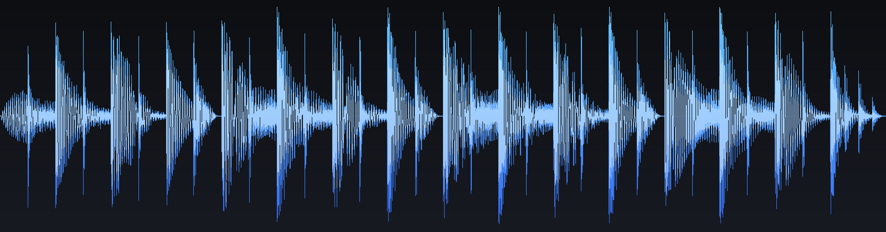
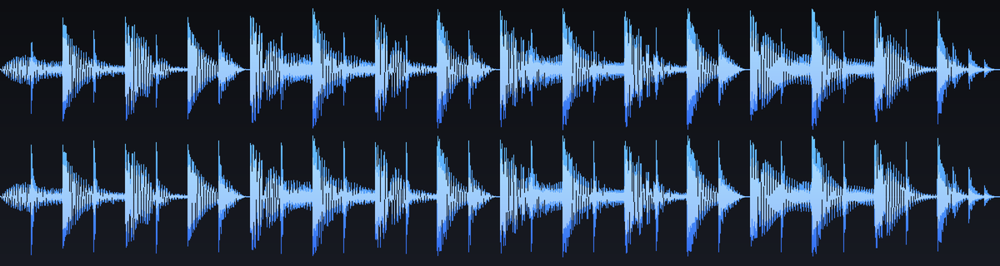
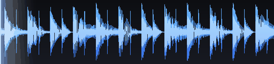
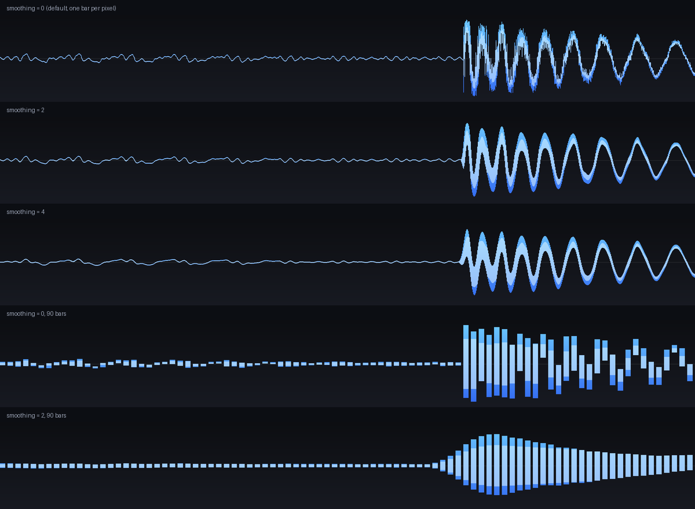
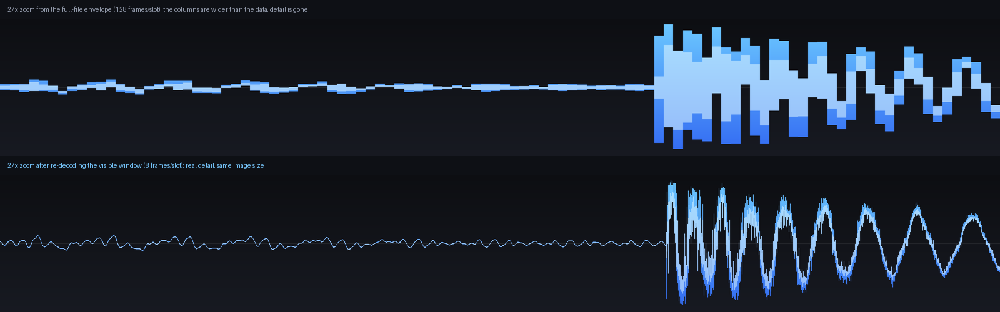
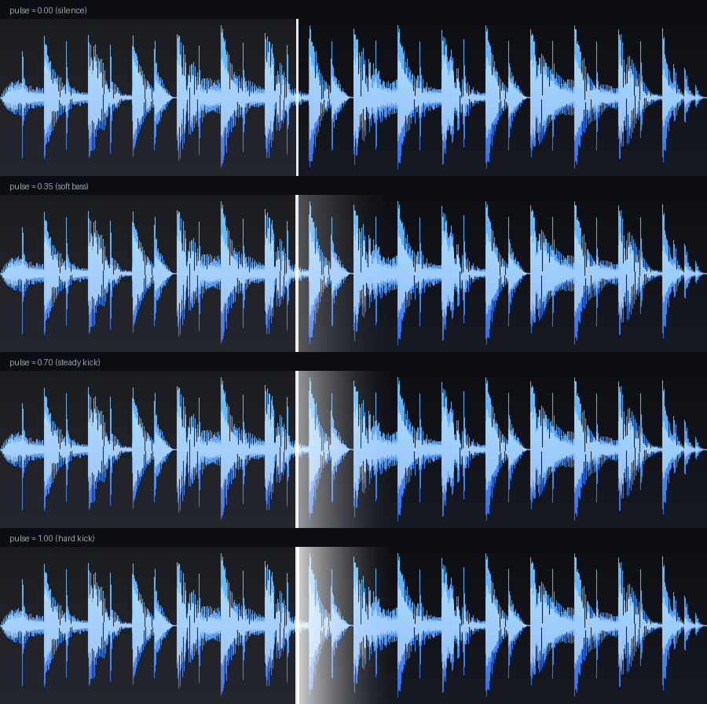
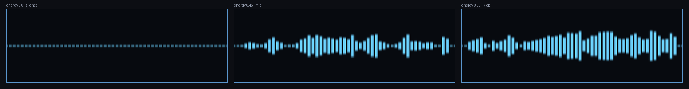

# Squircle Workshop — Rhythia beatmap editor + waveform toolkit

Squircle Workshop is a Godot 4.8 GDScript beatmap-editor prototype for Rhythia, a hover-to-hit rhythm game. Open `project.godot` and run the project to launch the editor. It opens on Metadata with Notes, Preview, and Export disabled until you import `.wav`, `.ogg`, or `.mp3` audio from the top waveform toolbar.

The editor includes Metadata, Notes, Preview, and Export workspaces; Notes, Preview, and Export stay disabled until audio is imported. In Notes, click the 3×3 playfield or press **Q W E / A S D / Z X C** to place notes at the playhead; use **Shift** to bypass position snapping. During playback, notes in both Notes and Preview fade in toward their hit time. Auto-advance gives a short reverberant audio cue. The waveform can be zoomed and bar-snapped while panning, with selectable beat divisions; its minimap remains fit to the whole track and click-drags to seek without annotations or zooming. Notes are created only on the playfield. Ctrl-click notes in Select mode to toggle multi-selection, right-click a note to delete, and right-drag empty waveform space to select a time range. The BPM graph is zoom-aware; click to add points (whole-BPM snapping, Shift for 0.01 BPM), drag to adjust, or right-click for focused numeric entry. Space toggles playback and the arrow keys navigate notes. Ctrl+Z / Ctrl+Y undo and redo, Ctrl+A selects notes in the current layer, and Delete removes selected notes. Use the marker-only Tree/Library browser, layers, and the inspector to organize and edit notes. Line is drawn by dragging from one endpoint to another; Path and Curve gestures bake to simple note objects. Export is deliberately marked WIP and currently shows verifier warnings rather than writing a Rhythia file.

The waveform is rendered by the included reusable toolkit below. Its cache, zoom/pan and decode implementation remain available for standalone projects.

## Waveform toolkit

Turn any audio file into a **waveform image** (`Image`, `ImageTexture` or a PNG on disk) and draw it
in a UI — with a playhead, click-to-seek, stereo split, **horizontal zoom** and full styling control.

No native plugins, no GDExtension, no pre-processing of the audio: the toolkit asks Godot's own mixer
to render the stream frame by frame, so `WAV`, `OGG` and `MP3` are all supported out of the box.




While the track plays, a **gradient pulse at the playhead** flares on every kick — it only listens to
30–100 Hz and to the *transient* part of it, so snares, hats and vocals barely move it. A **live shader
visualiser** sits in the bottom right corner:





*(Styling: the same 0.3 s window drawn with `smoothing = 0 / 2 / 4`, and with fewer, wider bars.)*

**Zoom is not a magnifying glass.** The visible window is always re-rendered at the full pixel width
of the control, and the audio is decoded **once** into a multi-resolution pyramid that is cached on
disk — so zooming reveals real detail, instantly, with no re-decoding and no quality switch while the
song plays:



*(Same 0.3 s window, same 1600×220 output: top = a coarse envelope (128 frames per slot),
bottom = the pyramid's fine level (8 frames per slot). One decode, two levels, no re-decoding at
zoom time.)*

---

## Requirements

| | |
|---|---|
| Engine | **Godot 4.5 or newer** (the project is set up for the Godot 4.8 API level; 4.8 was still in beta at the time of writing, so it also runs unchanged on 4.5 / 4.6 / 4.7) |
| Why 4.5+ | `AudioStreamPlayback.mix_audio()` — the method that makes CPU-side decoding possible — entered the scripting API in 4.5. The toolkit detects it and reports a clear error on older versions. |
| Platforms | Anything Godot runs on, including `--headless` (no audio device needed, the mixer works in software) |

---

## Run the demo

1. Open `project.godot` in Godot 4.8 (or 4.5+).
2. Press **F5**.

You get:

* the waveform of `samples/demo_track.wav` (a synthesised 8 s stereo track) on startup,
* **Open audio…** (or just drag a file onto the window) to load any `.wav`, `.ogg` or `.mp3`,
* **Play** to listen, **click / drag the waveform** to scrub,
* **Channels: mix / stereo / left / right** to switch how the envelope is drawn,
* **Follow: page flip / centered / off** — page flip jumps the window forward in blocks, centered keeps
  the playhead in the middle and slides a pre-baked strip so the scroll is smooth, off leaves the window
  alone,
* **mouse wheel over the waveform = zoom in/out around the cursor** (Shift + wheel, or middle/right
  drag = pan), the slider under the waveform scrolls the visible window, **Fit** returns to the
  whole track, and the label on the right shows the zoom, the visible length and the current
  resolution in *frames per slot*,
* **Export PNG** writes the **currently visible window** as a 1600×420 PNG to `res://exports/`
  (`song_waveform.png`, or `song_waveform_z12x.png` when zoomed) — so a zoomed export is a high
  resolution crop rather than an upscaled one,
* **Quality: auto / full / fast** — auto shows a flat preview while you zoom and the full gradient
  render as soon as you stop, full always renders at full quality, fast always stays flat,
* **Zoom at: cursor / playhead / center** — what the mouse wheel keeps in place while zooming,
* the **Smooth** slider restyles the bars live, and *Pulse* toggles the kick gradient,
* **Height** resizes the waveform vertically (or drag its bottom edge), **Scale** changes the vertical
  amplitude independently of zoom,
* while playing, the **gradient at the playhead flares on each kick** and the **shader visualiser in
  the bottom right** moves with the same energy,
* the first load of a file decodes it once and writes `user://waveform_cache/*.res`; every later load
  (also after restarting the demo) is a cache read — the status line says which one happened.

### Verify it on your machine

The toolkit ships with a headless test that bakes the sample file, renders images and checks the
numbers — geometry, the resolution pyramid (levels, `pick()`, serialisation), the loader's disk cache
(a second load must come from the cache, not from a decode) and the styling option (`smoothing`
changes pixels). Exit code 0 = all good:

```bash
godot --headless --path . --script res://tests/selftest.gd
# or against your own file:
godot --headless --path . --script res://tests/selftest.gd -- /absolute/path/song.mp3
```

---

## Project layout

```
project.godot
icon.svg
src/
  waveform_baker.gd      # decode AudioStream -> WaveformData   (class_name WaveformBaker)
  waveform_data.gd       # the envelope resource + column reduction (class_name WaveformData)
  waveform_renderer.gd   # envelope -> Image / ImageTexture / PNG (class_name WaveformRenderer)
  waveform_pyramid.gd    # multi-resolution waveform, built once (class_name WaveformPyramid)
  waveform_loader.gd     # decode once + cache on disk, background load (class_name WaveformLoader)
  waveform_view.gd       # Control: display, playhead, zoom/pan, pulse (class_name WaveformView)
  waveform_visualizer.gd # ColorRect widget around the shader    (class_name WaveformVisualizer)
shaders/
  waveform_visualizer.gdshader   # "waveforms" shader (CC0, godotshaders.com)
demo/
  demo.tscn, demo.gd     # runnable demo, UI built in code
tests/
  selftest.gd            # headless self-test (SceneTree script)
tools/
  bake_waveforms.gd      # EditorScript: batch-bake PNGs for a whole folder
  make_sample_audio.py   # regenerates samples/demo_track.wav (not needed to run the demo)
  preview_render.py      # Python mirror of the renderer, used to produce preview/*.png
  preview_pulse.py       # Python mirror of the playhead pulse -> preview/pulse_preview.gif
  preview_shader.py      # numpy port of the .gdshader -> preview/preview_visualizer.png
  preview_scroll.py      # follow-scroll jitter measurement -> preview/preview_scroll_compare.gif
  lint.py                # structural GDScript lint (indent, brackets, duplicate funcs)
samples/
  demo_track.wav
preview/
  preview_mix.png, preview_stereo.png, preview_bars.png, preview_transparent.png,
  preview_zoom_compare.png, preview_styles.png, preview_pulse.png, preview_visualizer.png,
  preview_scroll_compare.gif,
  pulse_preview.gif
exports/                 # PNGs written by the demo land here
```

The six scripts in `src/` are self-contained and use `class_name`, so **copying them into your own
project is enough** — no autoload, no plugin, no scene required.

---

## 30-second usage

```gdscript
extends Control

func _ready() -> void:
	# 1) load the whole waveform: decode once, then cache it on disk
	var loader := WaveformLoader.new()
	var pyramid: WaveformPyramid = await loader.load_pyramid("res://music/song.ogg")
	if pyramid == null:
		push_error(loader.last_error)
		return

	# 2) hand it to the interactive control - zoom, pan, seek, pulse, all free
	$WaveformView.pyramid = pyramid
	$WaveformView.seek_requested.connect(func(ratio: float) -> void:
		$Player.stream = WaveformBaker.load_audio_stream("res://music/song.ogg")
		$Player.play(ratio * pyramid.duration))

	# 3) or render straight to a texture / PNG from the same data
	$TextureRect.texture = WaveformRenderer.render_texture(pyramid.pick(1024, 1.0), {
		"width": 1024, "height": 256, "channel_mode": "stereo",
	})
	WaveformRenderer.save_png(pyramid.get_finest(), "user://song_waveform.png", {
		"width": 1920, "height": 480,
		"wave_color_top": Color("#7ee0ff"),
		"wave_color_bottom": Color("#2f6bff"),
	})
```

While audio plays, feed the playhead and the pulse:

```gdscript
func _process(_delta: float) -> void:
	if not $Player.playing:
		$WaveformView.pulse = 0.0
		return
	var t := $Player.get_playback_position() \
		+ AudioServer.get_time_since_last_mix() - AudioServer.get_output_latency()
	$WaveformView.playback_ratio = t / pyramid.duration
	$WaveformView.pulse = kick_energy           # 0..1, see "Playhead pulse" below
```

---

## Zoom, resolution & the cache

The vertical scale never changes (that would distort the amplitude); zooming is strictly on the time
axis, as a waveform editor should be.

### In the `WaveformView` control

| Input | Action |
|---|---|
| mouse wheel | zoom in / out, anchored under the cursor |
| Shift + wheel | pan left / right |
| middle or right mouse drag | pan |
| left click / drag | seek (emits `seek_requested`) |
| `zoom = 1.0`, `reset_view()` | back to the whole track |

```gdscript
view.zoom_at(2.0, 0.5)          # 2x closer, around the middle
view.set_view(0.25, 8.0)        # 8x zoom, starting at 25 % of the track
view.scroll_by(0.01)            # pan by 1 % of the track
print(view.get_view_range())    # Vector2(0.25, 0.375)
print(view.get_max_zoom())      # limit = one slot per pixel column of the finest level
```

### Follow the playhead

```gdscript
view.follow_playhead = true     # on by default
view.follow_style = "page"      # "page" (jump forward in blocks) or "center"
view.follow_lead = 0.12         # where the playhead lands after a page flip
view.follow_overscan = 0.5      # extra strip baked for "center" scrolling
```

`"page"` only moves the window when the playhead is about to leave it, so playback costs **one render
per page** instead of one per frame. `"center"` keeps the playhead pinned in the middle and scrolls the
waveform underneath it — and it does that by **sliding the texture, not by re-rendering it**:

* the texture is baked `follow_overscan` (default half a screen) wider than the view,
* every frame the view blits it at a whole-pixel offset, so the scroll costs one textured rect,
* only when the window reaches the end of that strip is a new one baked — about **once per second**
  at typical zoom levels instead of 60 times per second.

That split matters for looks, not just speed. A fresh render re-bins the envelope slots into the pixel
columns, and a window that has only moved a fraction of a slot re-bins them slightly differently — the
bar heights then wobble on every frame, which reads as the whole waveform *boiling* or *jittering*.
Sliding an existing texture cannot do that. `preview_scroll.py` measures it: on the demo track at 4×
zoom the mean bar-to-bar wobble drops from **1.75 px to 0.08 px** and the renders from 240 to 4 for four
seconds of scrolling.

Neither mode ever re-decodes audio — moving the window only re-reduces an envelope level.

### What stays in place while zooming

```gdscript
view.zoom_anchor = "cursor"     # keep the position under the mouse wheel (default)
view.zoom_anchor = "playhead"   # keep the playhead fixed, scroll the rest around it
view.zoom_anchor = "center"     # keep the middle of the window fixed
```

`"playhead"` is what you want for a DAW-style "zoom to the cursor line": the playhead stays where it
is on screen and the waveform stretches around it. If there is no playhead (or it is outside the
window) the view falls back to `"center"`.

### Smooth zooming on slow machines

A full quality render of a 1250×300 view costs 20–40 ms (every pixel column is walked row by row to
build the vertical gradient). One of those per mouse wheel notch is fine on a desktop and a slideshow
on a weak laptop, so the view has a quality knob:

| `preview_quality` | What happens | Cost per notch |
|---|---|---|
| `"auto"` *(default)* | flat preview immediately, full gradient render `quality_delay` (0.18 s) after the last interaction | ~2–4 ms while moving, one full render when you stop |
| `"full"` | always the full render — smoothest looking picture, no preview flash | 20–40 ms |
| `"fast"` | always the flat look (one `fill_rect` per bar, no RMS core, no supersampling) | ~2–4 ms |

```gdscript
view.preview_quality = "auto"    # default
view.quality_delay = 0.18        # seconds of idle before the full render
view.preview_quality = "full"    # if you hate the flat preview more than the stutter
```

Only the *image* is affected — the resolution level, the cache and the audio pipeline are identical in
all three modes, so this never changes what the waveform shows, only how it is shaded while moving.
Note that `"auto"` treats continuous `"center"` following as "still moving": the preview stays flat
while the waveform scrolls and the full gradient render arrives when it stops (set `"full"` if you want
the gradient during playback and can afford one render per second).

### Vertical size and scale

```gdscript
view.custom_minimum_size.y = 360   # how tall the waveform is
view.amplitude_scale = 1.4         # vertical scale of the bars (1 = normal)
```

* The height is ordinary `Control` sizing: put the view in a `VBoxContainer` with
  `size_flags_vertical = SIZE_FILL` and a height of your choice, or leave it stretching.
* `vertical_resize_enabled` (on by default) adds a drag handle at the bottom edge of the control —
  the user can grab it and resize the waveform vertically; the demo syncs its *Height* slider with it.
* `amplitude_scale` scales the drawn amplitude (it is passed to the renderer as `gain`, after the
  normalisation reference). It is deliberately **not** part of zooming, so the "vertical scale stays
  fixed while you zoom" rule still holds.

### One decode, many resolutions

Decoding an 8 s file takes ~0.5 s; a 4 minute track takes a few seconds. Doing that again every time
the user zooms would be slow *and* visible (the old implementation swapped in a cheap draft, then a
re-decoded window, which the eye reads as flicker). So the audio is decoded **once** at a fine step and
stored as a [WaveformPyramid]:

* `levels[0]` is the decoded envelope (e.g. 8 frames per slot), every following level halves the slot
  count (16, 32, 64… frames per slot) by a cheap reduction — minimums stay minimums, maximums stay
  maximums, RMS recombines from the squares. No audio decoding, a few milliseconds in total.
* When the view needs to draw, `pyramid.pick(columns, visible_fraction)` returns the **coarsest** level
  that still puts at least four slots into every pixel column. It is cheap to reduce (a few thousand
  slots per render) and draws the same picture as the finest level, because column edges land on slot
  boundaries — so zooming never pops.
* The step size is chosen automatically: `WaveformLoader.step_for_frames()` targets ~260k slots for the
  finest level (≈ 6 MB), clamped to 8…1024 frames per slot. For an 8 s file that is step 8; for a
  4 minute track step ≈ 40.
* The whole pyramid is a single `Resource`, cached at
  `user://waveform_cache/<hash>.res` and keyed by path + modification time + size + step + version.
  Loading it back is one threaded `ResourceLoader` read — no decoding at all, also across restarts.

```gdscript
var loader := WaveformLoader.new()
loader.progress.connect(func(r): $Bar.value = r)              # 0..1 while decoding
loader.stage_changed.connect(func(s): $Label.text = s)       # "cache" | "decode" | "levels" | "save"
var pyramid := await loader.load_pyramid("res://music/song.ogg")
print(loader.last_source)                                    # "cache" or "decode"

$WaveformView.pyramid = pyramid
print(pyramid.describe())            # WaveformPyramid(6 levels, step 8, 16, 32, ..., 44100 slots, 8.00s)
print(pyramid.pick(1200, 0.05))      # the level the view uses at 20x zoom
loader.clear_cache()                 # throw the disk cache away
```

| `WaveformLoader` | |
|---|---|
| `load_pyramid(path) -> WaveformPyramid` | Await this. Cache first, then a decode that yields to the main loop between chunks. |
| `load_pyramid_sync(path)` | Blocking variant for editor scripts / headless tools. |
| `build_pyramid(stream, label)`, `build_pyramid_sync(...)` | Same, for an `AudioStream` you already have. |
| `progress`, `stage_changed` | Signals for a loading bar / status line. |
| `use_cache`, `cache_dir`, `target_slots`, `fine_step` | Cache switch, cache folder, resolution target, forced step size. |
| `last_source`, `last_error`, `clear_cache()`, `cache_path_for(path)` | Diagnostics and housekeeping. |

| `WaveformPyramid` | |
|---|---|
| `build(fine: WaveformData, min_slots := 512)` | Builds every coarser level from one decoded envelope. |
| `pick(columns, visible_fraction, slots_per_column := 4.0)` | The level to draw for one pixel width / one zoom / one quality target. |
| `get_finest()`, `get_peak()`, `get_finest_slots()`, `get_finest_step()` | Accessors. |
| `get_level_count()`, `get_max_zoom(columns)`, `describe()` | Diagnostics; `get_max_zoom()` is what the view reports as the zoom ceiling. |
| `levels: Array[WaveformData]`, `peak`, `duration`, `sample_rate`, `channels` | Serialised state. |

### Without the control (offline / exports)

`WaveformRenderer` understands the same idea through two options — `view_start` and `view_end`
(0…1 of the envelope). Pick the level for the output size and render it:

```gdscript
# a 3000 px wide crop of the middle of the track, from the finest level
WaveformRenderer.save_png(pyramid.pick(3000, 0.1), "user://crop.png", {
	"width": 3000, "height": 500, "view_start": 0.45, "view_end": 0.55,
})
```

Or bake just a window, if you never need the rest of the file:

```gdscript
var baker := WaveformBaker.new()
var window: WaveformData = await baker.bake_stream_range(stream, 12.0, 2.0, 8)
WaveformRenderer.save_png(window, "user://crop.png", {"width": 3000, "height": 500})
```

---

## API

### `WaveformBaker` — decoding

| Member | Description |
|---|---|
| `bake_file(path) -> WaveformData` | `await`-able. Loads (through `ResourceLoader` or `AudioStreamWAV/MP3/OggVorbis.load_from_file()`, so absolute paths picked with a `FileDialog` work too) and decodes. Uses the disk cache. |
| `bake_stream(stream) -> WaveformData` | `await`-able variant for a stream you already have. Yields between chunks, so a progress bar keeps animating. |
| `bake_file_sync(path)` / `bake_stream_sync(stream)` | Blocking versions for editor tools / batch scripts. |
| `bake_stream_range(stream, start_time, window_seconds, step)` | `await`-able. Decodes **only** `[start_time, start_time + window_seconds)` at a finer `step` (audio frames per envelope slot, `1` = per-frame). Sets `WaveformData.window_start`. This is what powers high-resolution zooming. Not cached. |
| `bake_stream_range_sync(...)` | Blocking variant. |
| `load_audio_stream(path) -> AudioStream` | Static helper: `.wav` / `.ogg` / `.mp3` → `AudioStream`, from `res://`, `user://` or an absolute path. |
| `is_supported_file(path) -> bool` | Static helper for filters / drag-and-drop checks. |
| `last_error: String` | Why the last call returned `null`. |
| `progress_changed(ratio)` | Signal, 0…1 while decoding. |
| `clear_cache()` | Deletes the cached envelopes. |
| Properties | `step_size` (128), `chunk_frames` (32768), `max_seconds` (1800), `chunks_per_yield` (8), `yield_frames` (true), `use_cache` (true), `cache_dir` (`user://waveform_cache`). |

### `WaveformData` — the envelope (`Resource`, cache-friendly)

The track is cut into slots of `step_size` audio frames; each slot stores min / max / RMS per channel.

| Member | Description |
|---|---|
| `sample_rate`, `duration`, `frame_count`, `channels`, `step_size` | Metadata (frames are always at the AudioServer mix rate). |
| `window_start` | Start of this envelope inside the file, in seconds (`0` for full-file bakes, non-zero for range bakes). `get_window_end()` returns the end. |
| `min_l`, `max_l`, `rms_l`, `min_r`, `max_r`, `rms_r` | `PackedFloat32Array` per slot, amplitudes in −1…1. The right channel arrays are empty for mono sources. |
| `reduce(column_count, channel, slot_from, slot_to) -> Columns` | Collapses the envelope into N columns (`min_values`, `max_values`, `rms_values`). Cheap, call it on every resize/zoom. `channel` = `CHANNEL_MIX` / `CHANNEL_LEFT` / `CHANNEL_RIGHT`; `slot_from`/`slot_to` restrict it to a slice of the envelope (-1 = all), which is how the renderer zooms. |
| `has_stereo()`, `get_slot_count()`, `get_peak()`, `get_peaks()`, `get_slot_duration()` | Helpers. |
| `get_amplitude_at_time(t) -> float` | Handy for reactive visuals / VU-style effects (accounting for `window_start`). |
| `get_slot_at_time(t) -> int` | Slot index containing a given time. |
| `describe() -> String` | Debug one-liner. |

Because it is a `Resource`, you can bake once and ship the `.res`:

```gdscript
ResourceSaver.save(data, "res://music/song_waveform.tres")
...
var data: WaveformData = load("res://music/song_waveform.tres")
```

### `WaveformRenderer` — drawing

| Member | Description |
|---|---|
| `render(data, options) -> Image` | Render to an `Image`. |
| `render_texture(data, options) -> ImageTexture` | Render straight to a texture. |
| `save_png(data, path, options) -> Error` | Render and write a PNG (`res://`, `user://` or absolute; parent folders are created). |
| `bake_and_save(audio_path, png_path, options) -> Error` | Static one-shot: decode a file and write its PNG, blocking. |
| `default_options() -> Dictionary` | All options with their defaults. |

Options (pass only what you want to change):

| Key | Default | Meaning |
|---|---|---|
| `width`, `height` | `1200`, `256` | Output size in pixels. |
| `columns` | `0` | Number of distinct waveform columns; `0` = one per pixel column. |
| `supersample` | `2` | Render N× larger and downscale with Lanczos (anti-aliasing). `1` is fastest. |
| `padding` | `10` | Margin above/below the bars, in px. |
| `bar_gap` | `0` | Space between bars in px. `> 0` automatically thins out the column count so bars stay ≥ 1 px wide. |
| `min_bar_height` | `1` | Thinnest bar, keeps silence visible. |
| `background`, `background_bottom` | dark slate | Vertical background gradient. |
| `transparent` | `false` | Ignore both background colours (RGBA output). |
| `wave_color_top`, `wave_color_bottom` | cyan → blue | Vertical gradient of the bars. Set both equal for a flat colour. |
| `draw_rms`, `rms_color` | `true`, white 55 % | Brighter core inside each bar (perceived loudness). |
| `channel_mode` | `"mix"` | `"mix"`, `"stereo"` (two lanes), `"left"`, `"right"`. |
| `stereo_gap` | `6` | Gap between the L/R lanes, in px. |
| `center_line_color` | white 8 % | Zero-amplitude line. Set alpha `0` to hide. |
| `normalize`, `gain` | `true`, `1.0` | Scale the loudest peak to the edges, then apply extra gain. |
| `peak` | `0.0` | Normalisation reference. `0` = use the peak of the data you pass in; set it to the whole-track peak to keep the vertical scale identical across several renders. The view always passes `pyramid.get_peak()`, so switching levels while zooming never makes the waveform look louder. |
| `view_start`, `view_end` | `0.0`, `1.0` | Visible slice of the envelope, stretched across the whole image width — the horizontal zoom of the offline renderer. |
| `smoothing` | `0` | Blur radius **in columns**; runs two box-blur passes over the min/max/RMS arrays and turns a spiky envelope into a soft, drawn-looking wave. `0` = off, `2`–`8` = progressively softer. |

### `WaveformView` — the `Control`

**Look (exported):** `wave_color_top`, `wave_color_bottom`, `draw_rms`, `rms_color`, `background`,
`background_bottom`, `padding`, `bar_gap`, `channel_mode`, `playhead_color`, `played_tint`,
`render_supersample` (1 = fastest, 2 = smoother).

**Style (exported):** `smoothing` (blur radius in columns, 0 = off), `amplitude_scale` (vertical
scale, 1 = normal), `vertical_resize_enabled` (drag the bottom edge to change the height).

**Performance (exported):** `preview_quality` (`"auto"` / `"full"` / `"fast"`), `quality_delay` (0.18 s
— how long after the last zoom/pan the full render replaces the preview).

**Playback (exported):** `follow_playhead` (true), `follow_style` (`"page"` / `"center"`),
`follow_lead` (0.12), `follow_overscan` (0.5 — extra width baked for `"center"` scrolling, so the
texture can slide instead of being re-rendered).

**Zoom (exported):** `max_zoom` (512), `zoom_step` (1.25 = wheel multiplier), `zoom_anchor`
(`"cursor"` / `"playhead"` / `"center"` — what stays in place while zooming).

**Playhead pulse (exported):** `pulse_enabled`, `pulse_width` (180 px), `pulse_color` (white),
`pulse_flip` (fade to the left instead), `pulse_max_opacity` (0.9), `pulse_decay` (0 = the level is
only set from outside).

**Runtime API**

| Member | Description |
|---|---|
| `pyramid: WaveformPyramid` | The multi-resolution waveform to draw — what you normally assign. |
| `data: WaveformData` | A single envelope, used when no pyramid is set (previews, one-off cases). |
| `playback_ratio: float` | Playhead 0…1 of the whole track, negative hides it. |
| `zoom: float` | Current zoom, `1.0` = whole track. |
| `view_start: float` | Left edge of the visible window, 0…1 of the whole track. |
| `zoom_at(factor, anchor)`, `zoom_by(factor)` | Zoom keeping a time position fixed / zoom around the centre. |
| `scroll_by(delta)`, `set_view(start, zoom)`, `reset_view()` | Panning helpers. |
| `pulse: float` | Level 0…1 that drives the opacity of the gradient at the playhead. |
| `set_pulse(energy)` | Same as assigning `pulse`, reads better inside a `_process()`. |
| `get_amplitude_at_playhead()` | Peak amplitude (0…1) of the slot under the playhead — a free level source if you have no bus analyser. |
| `get_view_range()`, `get_visible_fraction()`, `get_max_zoom()` | State queries. |
| `get_effective_step_size()`, `get_current_level()` | Frames per slot of the level being drawn, and the level itself. |
| `queue_rebuild()`, `get_texture()`, `get_render_options()` | Force a redraw / grab the texture / override the internal render options (the view adds `view_start`/`view_end` itself). |
| `seek_requested(ratio)`, `view_changed(start, zoom)`, `texture_rebuilt` | Signals. |

The texture is re-rendered at the exact pixel size of the control whenever it is resized or the view
moves, from the pyramid level that suits that size — so it never gets blurry, never simply magnifies
pixels, and never has to decode audio in order to zoom.

---

## Styling: smoothing


`smoothing` lives on the renderer *and* on the view, and it costs nothing at runtime — the shaping
happens while the image is being built:

```gdscript
# offline render
WaveformRenderer.save_png(pyramid.pick(1600, 1.0), "user://soft.png", {
	"width": 1600, "height": 300,
	"smoothing": 4,      # two box-blur passes over the columns (radius in columns)
	"columns": 180,      # fewer, wider bars
	"bar_gap": 4,
	"min_bar_height": 3,
})

# live in the control
view.smoothing = 4
```

* **`smoothing`** blurs `min_values` / `max_values` / `rms_values` with two box-blur passes (a cheap
  triangular kernel). The radius is in **columns**, so the same value smooths a longer stretch of time
  when the track is squeezed into few columns, and a shorter one when you are zoomed in. Peaks get
  lower and valleys higher — that is the point.
* `0` keeps the untouched envelope; `2`–`4` is the sweet spot for a hand-drawn look, `8` turns the
  waveform into slime.

---

## Playhead pulse



A single gradient image sits at the playhead: opaque at the head, fading to fully transparent over
`pulse_width` pixels. Setting `pulse` (0…1) only changes its opacity, so a kick makes it flare without
any per-frame image work — one `draw_texture_rect` call.

```gdscript
view.playback_ratio = t / duration
view.pulse = kick_energy          # 0 = invisible, 1 = full white gradient
```

| Export | Default | Meaning |
|---|---|---|
| `pulse_enabled` | `true` | Master switch. |
| `pulse_width` | `180.0` | Length of the gradient in pixels. |
| `pulse_color` | white 90 % | Colour at the playhead; the far end is always transparent. |
| `pulse_flip` | `false` | Fade to the left (behind the playhead) instead of to the right. |
| `pulse_max_opacity` | `0.9` | Opacity when `pulse == 1.0`. |
| `pulse_decay` | `0.0` | Level decay per second; `0` = you set the level yourself (recommended). |

### Making it kick-driven (and only kick-driven)

Two things matter: measure **only the low band**, and react to the **transient** rather than to the
level. This is what the demo does:

```gdscript
const BASS_RANGE := Vector2(30.0, 100.0)   # kick + sub bass, nothing else
const KICK_EMPHASIS := 2.0

# once: a bus with a spectrum analyser, player routed into it
var index := AudioServer.bus_count
AudioServer.add_bus(index)
AudioServer.set_bus_name(index, "Music")
AudioServer.set_bus_send(index, "Master")
var analyzer := AudioEffectSpectrumAnalyzer.new()
analyzer.fft_size = AudioEffectSpectrumAnalyzer.FFT_SIZE_1024
AudioServer.add_bus_effect(index, analyzer)
var spectrum := AudioServer.get_bus_effect_instance(index, 0) as AudioEffectSpectrumAnalyzerInstance
$Player.bus = "Music"

# every frame
func _update_pulse(delta: float) -> void:
	var magnitude := spectrum.get_magnitude_for_frequency_range(BASS_RANGE.x, BASS_RANGE.y,
			AudioEffectSpectrumAnalyzerInstance.MAGNITUDE_AVERAGE).length()
	var level := clampf((log(maxf(magnitude, 0.00001)) + 9.2) / 5.0, 0.0, 1.0)   # dB -> 0..1

	peak_level = maxf(level, peak_level - delta * 0.25)                          # rolling normalisation
	level = clampf(level / maxf(peak_level, 0.3), 0.0, 1.0)

	slow = lerpf(slow, level, clampf(delta * 2.5, 0.0, 1.0))                     # slow average
	var transient := clampf((level - slow) * KICK_EMPHASIS + level * 0.35, 0.0, 1.0)

	# fast attack, slower release: a hit, not a wobble
	var speed := 0.6 if transient > view.pulse else 0.14
	view.pulse = lerpf(view.pulse, transient, speed)
```

* **Band-limited** (30–100 Hz) means snares, hats, guitars and vocals are simply not measured, so they
  cannot move the pulse.
* **`level - slow`** is a transient detector: a sustained bass note settles to a steady level and the
  difference becomes ~0, while a kick spikes it. That is why the pulse snaps on the kick and stays
  quiet during the note in between.
* The rolling peak keeps it working for quiet and loud tracks alike, and the attack/release smoothing
  turns a raw per-frame number into something that reads as a flash rather than a flicker.

No analyser at hand? `view.get_amplitude_at_playhead()` returns the peak of the envelope slot under the
playhead — broadband, so less kick-selective, but free:

```gdscript
view.pulse = clampf(view.get_amplitude_at_playhead() * 1.6, 0.0, 1.0)
```

---

## Live shader visualiser

In the demo the bottom right corner of the waveform is a live shader that reacts to the same bass
energy as the playhead pulse:



*(The "waveforms" shader at `energy` 0 / 0.45 / 0.95 — stills produced from the shader source by
`tools/preview_shader.py`, a numpy port of the `.gdshader`.)*

The shader is the **"waveforms"** shader from
[godotshaders.com/shader/waveforms](https://godotshaders.com/shader/waveforms) (CC0), kept in
`shaders/waveform_visualizer.gdshader` with its credit header. One line had to be fixed for Godot 4:
the colour uniform declared `hint_color`, which no longer exists in 4.x shaders and makes the compiler
reject the uniform — it is `source_color` now. `src/waveform_visualizer.gd` wraps
it in a `ColorRect` (`class_name WaveformVisualizer`) so you only deal with a handful of properties
and a single `energy` value:

```gdscript
# any ColorRect with this script / class:
%Visualizer.energy = bass_level      # 0..1 -> the shader's "progress" uniform
%Visualizer.wave_color = Color("6bd0ff")
%Visualizer.lines = 56
%Visualizer.idle_level = 0.18        # how much movement remains at silence
```

**Run it manually without the demo**

1. Add a `ColorRect` to your scene, make it ~320×120 px.
2. Attach `src/waveform_visualizer.gd` (or `WaveformVisualizer.new()` in code) — it loads the shader
   itself and creates the `ShaderMaterial`.
3. Set `energy` every frame from whatever level you like (bass band, RMS, an envelope follower).

Useful shader uniforms exposed by the wrapper: `lines`, `wave_color`, `amplitude`, `intensity`,
`frequency`, `speed`, `speech_sim`, `dot_matrix`, `idle_level`. Everything else can be set directly on
the material if you need it (`line_size`, `line_sharpness`, `fade`, `rest_size`, `edge`,
`speech_intensity`, `dot_matriz_size`).

`energy` is mapped onto the shader's own `progress` uniform as
`progress = idle_level + (1 - idle_level) * energy`, so `idle_level` (0.18 in the demo) decides how
much the wave still moves while nothing plays.

In the demo the widget is anchored to the bottom right corner of the waveform view (a translucent
`PanelContainer` with `mouse_filter = IGNORE`, so scrubbing still works underneath it).

---

## Baking PNGs offline (recommended for real projects)

Decoding at runtime costs a few dozen milliseconds to a few hundred per track — usually fine — but for
a shipped game you normally want the images pre-made:

1. Drop your `.wav` / `.ogg` / `.mp3` files into a folder (the script defaults to `res://samples`).
2. Open `tools/bake_waveforms.gd` in the script editor.
3. **File ▸ Run** (Ctrl/Cmd + Shift + X).

Every file becomes `res://waveforms/<name>_waveform.png` with the options in `IMAGE_OPTIONS`.
You can also do it from a `@tool` script or CI with `WaveformRenderer.bake_and_save()`.

---

## How it works (and why)

Godot exposes the raw PCM data of a `AudioStreamWAV` (`.data`), but **not** of OGG/MP3, which are
decoded inside the audio thread by their playback classes. The portable trick used here:

```gdscript
var playback := stream.instantiate_playback()   # a real, engine-side decoder
playback.start(0.0)
var frames := playback.mix_audio(1.0, 32768)    # PackedVector2Array of (left, right) samples
```

`mix_audio()` pulls samples *on demand*, so:

* no `AudioStreamPlayer`, no bus, no `AudioEffectCapture`, no real-time playback (capturing through a
  bus would take exactly as long as the song — this takes milliseconds),
* it works for every stream type Godot can play, including imported `.ogg`/`.mp3` and QOA/IMA-ADPCM WAVs,
* loops are disabled on a duplicated stream before decoding, otherwise the mix never ends,
* decoding is chunked and `await`s a frame between chunks, so the UI/progress bar stays alive.

The output is down-sampled into envelope slots while decoding (min/max/RMS per step), which is what the
renderer then reduces to pixel columns — so resizing the window re-renders from the envelope instead of
decoding the audio again.

Decoding happens **once per file**. `WaveformLoader` decodes at a step small enough for deep zooming
(target ≈ 260k slots), wraps the result in a `WaveformPyramid` (the same envelope at 8, 16, 32, 64…
frames per slot, built by reduction) and writes the whole thing to `user://waveform_cache/`. Everything
afterwards — zoom, pan, seek, resize, restart — reads a resolution level out of that resource, so the
view never touches the decoder again. `bake_stream_range()` still exists for one-off window bakes
(tools, thumbnails, exports of a slice), but the interactive view does not need it.

### Cost

* Decoding: a few hundred thousand frames per second of GDScript time — an 8 s track bakes in ~30–60 ms;
  a 5 min track in well under a second. The envelope for 1 minute of stereo audio is ~0.5 MB of RAM.
* Building the pyramid from a decoded envelope is one reduction pass per level (a few ms even for a
  4 minute track) and saves as a single resource: ~6 MB at the default target of 260k slots (6 float32
  arrays per slot), which is what makes every later load a cache read.
* `bake_stream_range()` still decodes only the visible window, so it costs a few milliseconds regardless
  of how long the file is - handy for one-off crops.
* Rendering: the gradient path fills spans **row by row**, merging touching columns into single
  `Image.fill_rect()` calls, so the native call count stays close to the image height instead of
  `columns × pixels`. A 1200×300 view renders in roughly 20–40 ms; with flat colours it is ~1 call per
  bar and takes a few milliseconds. `supersample = 2` roughly quadruples the pixel work — worth it for
  exports, not needed for the live view. The view re-renders only when the window, the size or a style
  option changes, never per frame while playing.

---

## Gotchas

* **Loops are ignored** — the envelope always covers the whole file once, `LOOP_*` streams included.
* The timeline uses the **AudioServer mix rate** (`audio/driver/mix_rate`, 44100 by default), not the
  file's own rate; `duration` therefore matches the file within a millisecond.
* **Mono streams** produce only the `_l` arrays; `has_stereo()` returns `false` and `"stereo"` mode
  silently falls back to a single lane.
* `Image.fill_rect()` overwrites pixels including alpha — that is why translucent options (centre line,
  RMS core) are pre-blended against the background/gradient in the renderer. If you add your own
  translucent overlays, blend them yourself.
* Very long files: `max_seconds` (default 1800) caps the decode; raise it if you need more.
* `.ogg` and `.mp3` decoding is delegated to Godot's decoders, so the waveform matches what the engine
  actually plays (including any seek imprecision at the very start of MP3s).
* If `mix_audio()` is missing you are on Godot < 4.5 — the baker says so in `last_error`.
* **Zoom is horizontal only.** The vertical scale is intentionally fixed per channel lane; the same
  gain/normalisation is used at every zoom level so amplitude comparisons stay honest.
* The zoom ceiling is the resolution of the finest pyramid level (`get_max_zoom()`): one slot per pixel
  column. Want more? Raise `WaveformLoader.target_slots` (and accept a bigger cache file), or lower
  `fine_step` explicitly.
* The cache key contains the file's modification time and size, the step size and
  `WaveformPyramid.CACHE_VERSION` — edit the audio, change the resolution or bump the version and the
  file is rebuilt. Delete `user://waveform_cache/` (or call `clear_cache()`) to start over.
* Range bakes start decoding at `playback.start(start_time)`; MP3 seeking is decoder-accurate to
  within a frame or two, so a window bake can be off by a few milliseconds at its left edge.
* `bake_stream_range()` is not cached on disk; it is meant to be cheap and disposable.
* `smoothing` is a radius in **columns**, not in seconds — a value that looks right on the whole
  track will be almost invisible when zoomed in (many more columns over the same audio).
* The pulse is a draw-time overlay: it never invalidates the texture, it is one textured rect per
  frame, and the gradient image is rebuilt only when `pulse_color` changes.
* The pulse needs a level from you: a bus analyser (see above), `get_amplitude_at_playhead()`, or your
  own beat detector. `pulse_decay = 0` means the view never animates it on its own.
* `follow_style = "center"` slides an overscanned texture and re-bakes it roughly once per second (see
  [Follow the playhead](#follow-the-playhead)). `follow_overscan` trades memory and one-time render cost
  for that interval: 0 = back to a render per scroll step, 1.0 = a whole extra screen of waveform.
* A 1-pixel move of the window changes nothing on screen, so the view ignores sub-pixel follow steps and
  never scrolls backwards for less than 2 px — audio playback positions wobble by a millisecond or two,
  which at a tight zoom would otherwise shake the waveform.
* `preview_quality = "auto"` replaces the full render with a flat preview while you zoom *or scroll*:
  that is a deliberate trade (the old "draft" behaviour) and the only mode where you can see the shading
  change.
  Use `"full"` for a rock-steady picture, `"fast"` for the cheapest one.

---

## Regenerating the assets

```bash
python3 tools/make_sample_audio.py   # writes samples/demo_track.wav
python3 tools/preview_render.py      # writes preview/*.png (Python mirror of the renderer)
python3 tools/preview_pulse.py       # writes preview/preview_pulse.png + preview/pulse_preview.gif
python3 tools/preview_shader.py      # writes preview/preview_visualizer.png (shader stills)
python3 tools/preview_scroll.py      # measures follow-scroll jitter, writes preview/preview_scroll_compare.gif
python3 tools/lint.py .              # structural GDScript lint - everything under the project
```

`tools/preview_render.py` is a line-by-line port of `WaveformRenderer.render()` used to sanity-check
the geometry without the engine; `tools/preview_pulse.py` does the same for the playhead pulse and the
kick detector (`FFT -> dB -> rolling normalisation -> transient -> attack/release`);
`tools/preview_shader.py` is a numpy port of the visualiser shader. None of them is part of the Godot
project — they only exist so the previews in this README can be generated and checked on a machine
without Godot.
